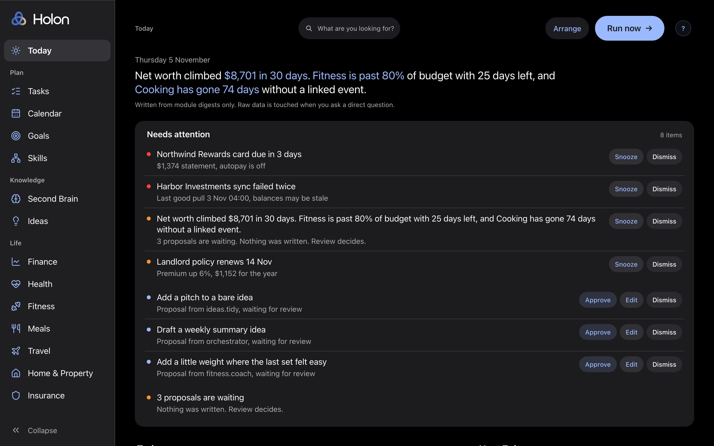
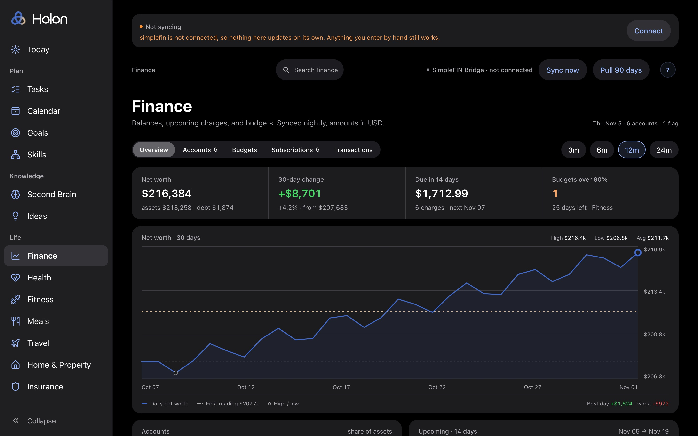
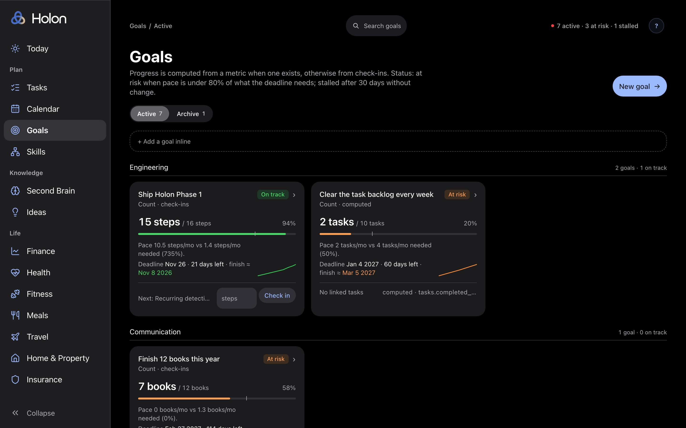
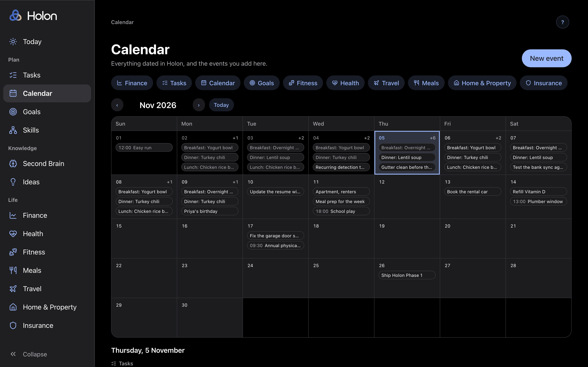

# Holon

A personal operating system. Single user, modular, fork and fill.

- docs/ARCHITECTURE.md: how it is built and how a module or integration plugs in.
- docs/SPEC.md: what each module does.
- docs/RESTORE.md: what to do when the database is gone.
- SETUP.md: workspace setup and the per-module loop.
- CLAUDE.md: rules for Claude Code sessions in this repo.

## Screenshots

Every screen below runs on the synthetic rows from `pnpm setup:demo` and the e2e fixture. None of it is real data.

| Today | Finance |
|---|---|
|  |  |
| **Goals** | **Calendar** |
|  |  |

## Quickstart for a fork

Needs Docker Desktop, Node 22, pnpm, and the Supabase CLI.

```
pnpm i
supabase start                   # prints the API URL and the two keys
cp .env.example .env             # fill Supabase keys, OWNER_EMAIL, ENCRYPTION_KEY, CRON_SECRET, MCP_TOKEN
pnpm setup:demo                  # migrations, owner user, synthetic rows
pnpm dev                         # log in, then Settings > Connections
```

`pnpm setup` does the same without the synthetic rows. Both are idempotent, so
rerunning them is safe. The app is empty until you paste an Anthropic key
(classification), a Voyage key (search), and a Resend key (the digest email) on
the Connections page. Nothing in this repo holds anything personal.

## Checks

```
pnpm typecheck && pnpm lint && pnpm test
pnpm test:e2e                    # Playwright, every screen at 1440px and 402px
```

Tests build their own `pos_test` database from the migrations and never touch
your development data.

MIT licensed.
